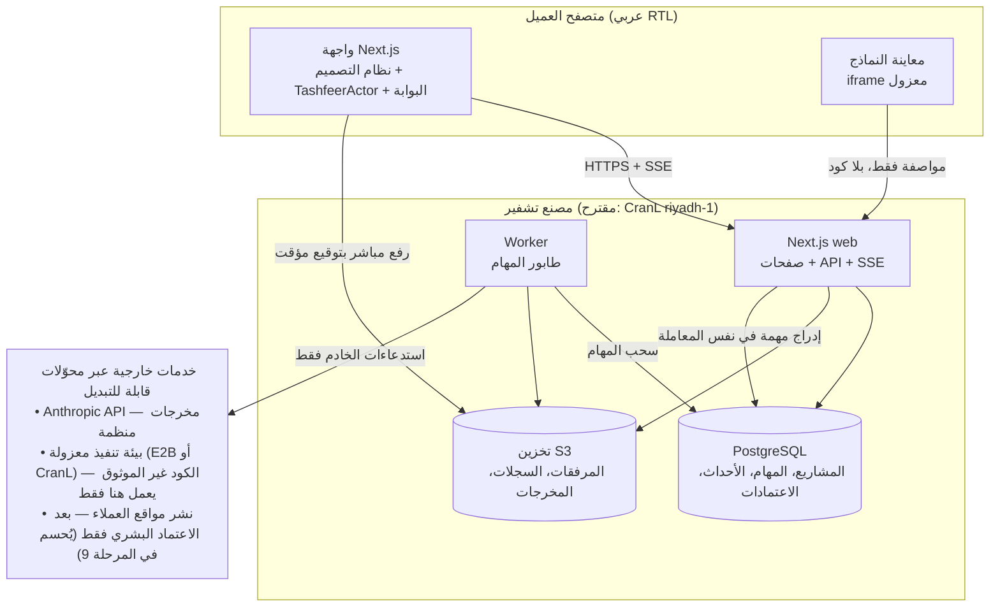
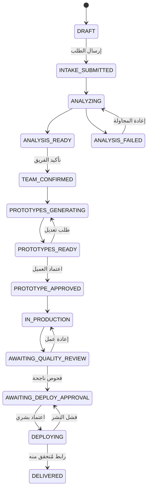

# خطة تنفيذ النسخة الأولى (MVP) — مصنع تشفير

تاريخ الخطة 2026-10-21. مبنية على `docs/REPO_AUDIT.md` و`docs/ASSET_INVENTORY.md` و`03-docs/MASTER_PROMPT_CLAUDE_PRO_MVP.md`. معايير القبول التفصيلية في `docs/ACCEPTANCE_TESTS.md`.

**مفتاح الرموز:** **[مؤكد]** متحقق منه. **[مقترح]** توصية تحتاج اعتمادك. **[قرار مطلوب]** يعود لك. **[افتراض]** فرضية عمل تُراجع.

---

## 0. ملخص التوصية

1. **[مقترح]** تطبيق Next.js واحد بلغة TypeScript في جذر المستودع، بجانب مجلد الحزمة الذي يبقى مرجعًا للقراءة فقط. يعمل منه **عمليتان**: الويب، وعامل الخلفية للمهام الطويلة. البيانات في PostgreSQL، والملفات في تخزين متوافق مع S3.
2. **[مقترح]** عشر مراحل (0–9) بدل التسع المقترحة في البرومبت. أضفت **مرحلة أساس البيانات** مبكرًا، وقدّمت **التحليل بالذكاء الاصطناعي على اختيار الوكلاء**. السبب: البرومبت يشترط أن تُحفظ المرفقات فعليًا مع المشروع (القسم E)، وأن يأتي ترشيح الوكلاء من تحليل حقيقي (القسم G)، وكلاهما يحتاج ما قبله.
3. **[مقترح]** المراحل 1–4 لا تحتاج أي خدمة خارجية ولا مفاتيح. أول احتياج مالي واعتمادات هو مفتاح Anthropic في المرحلة 5، ثم بيئة التنفيذ المعزولة في المرحلة 8.
4. **[مقترح]** حركة البوابة تُنقل **كما هي بالأرقام نفسها** أولًا، ثم أي تحسين بموافقتك فقط.
5. **[مقترح]** النماذج A/B الحقيقية تُبنى من **مكتبة مكونات مقيدة تفسر مواصفة JSON يولدها الذكاء الاصطناعي**، لا من كود عشوائي ينفَّذ في الخادم. الكود الفعلي للمنتج يُولَّد ويُبنى ويُختبر داخل بيئة معزولة فقط.
6. **عوائق معروفة الآن:** 3 صور وكلاء ناقصة، وقرار سطوع صور الوكلاء التسع، وقرار مرجعية الألوان، وحساب Anthropic API، ومزود التنفيذ المعزول، وخطة CranL. القائمة الكاملة في §8.

---

## 1. المبادئ الحاكمة

1. **لا ادعاء بلا دليل:** لا يظهر «مكتمل» أو «ناجح» أو «آمن» أو «منشور» أو رابط تسليم إلا عند وجود السجل المقابل في قاعدة البيانات. وأي اختبار لم يُشغَّل لا يُقال إنه نجح.
2. **غياب الاعتمادات حالة صريحة:** إذا غاب مفتاح أو خدمة، يعرض المنتج «يتطلب إعدادًا» مع اسم المتغير الناقص، ولا يحاكي النجاح.
3. **البوابات تُفرض في الخادم:** الإنتاج لا يبدأ بلا اعتماد نموذج، والنشر لا يبدأ بلا فحوص ناجحة واعتماد بشري. الواجهة تعكس هذا فقط.
4. **مدخلات العميل غير موثوقة:** الملفات والروابط والمستودعات والنصوص بيانات لا تعليمات. لا تنفيذ لأي كود خارج البيئة المعزولة.
5. **الهوية من مصدر واحد:** رموز الألوان والطباعة والزجاج والخلفية في نظام تصميم مشترك. لا تخترع أي صفحة درجة خضراء خاصة بها.
6. **الحفاظ على المعتمد:** التكوين البصري وحركة البوابة يُنقلان أولًا كما هما، والتغيير بعد موافقتك.
7. **التوثيق أولًا:** كل مرحلة تنتهي بتقرير نتائج حقيقي، ولقطات شاشة، وتحديث هذه الوثائق.

---

## 2. البنية المقترحة

| المكون | المسؤولية |
|---|---|
| **web** | الصفحات، التحقق من المدخلات، المصادقة والصلاحيات، توقيع روابط الرفع، قراءة الحالة، بث الأحداث الحية (SSE) مع الاستئناف بعد التحديث |
| **worker** | كل عمل طويل أو خارجي: استدعاءات الذكاء الاصطناعي، توليد النماذج، أوامر البيئة المعزولة، جمع المخرجات، إعادة المحاولة |
| **PostgreSQL** | مصدر الحقيقة لكل شيء، بما فيه سجل الأحداث وطابور المهام |
| **تخزين S3** | الملفات الثنائية والسجلات الكبيرة والمخرجات؛ الوصول بروابط موقعة قصيرة العمر بعد التحقق من الملكية |
| **المعاينة** | تفسير مواصفة النموذج بمكونات معتمدة داخل iframe بأصل منفصل ودون صلاحيات على جلسة المصنع |

**[مقترح]** في التطوير والاختبار: PostgreSQL محلي وتخزين على القرص بنفس الواجهة البرمجية، فلا تحتاج المراحل 1–4 أي حساب خارجي.

---

## 3. التقنيات المقترحة

| الطبقة | الاختيار المقترح | السبب |
|---|---|---|
| الإطار | Next.js (App Router)، أحدث إصدار مستقر عند التهيئة | يطابق نطاق MVP في البرومبت (React/Next.js/TypeScript) |
| اللغة | TypeScript صارم | أمان الأنواع عبر الواجهة والخادم والمواصفات |
| التنسيق | Tailwind CSS مربوط بمتغيرات CSS من مصدر واحد `tokens.css` | رموز الهوية في مكان واحد |
| الحركة | **Web Animations API لنقل حركة البوابة حرفيًا**؛ ومكتبة Motion (Framer Motion سابقًا) للحركات الصغيرة عند الحاجة | النموذج المعتمد مكتوب بـ WAAPI، والنقل الحرفي يحفظ التوقيتات دون إعادة تأليف. GSAP غير لازم الآن. Three.js فقط إذا وصل مجسم مُجهّز بهيكل |
| التحقق | Zod لكل مدخل ومخرج، بما فيه مخرجات الذكاء الاصطناعي | المخرجات المنظمة في Anthropic لا تدعم قيود الطول والأرقام، فيلزم تحقق إضافي |
| ORM | Prisma | مذكور في متطلباتك السابقة، ويوفر ترحيلًا قابلًا للتكرار |
| طابور المهام | **pg-boss على PostgreSQL** (البديل: BullMQ + Redis) | خدمة أقل، وإدراج المهمة في نفس معاملة السجل، فلا تضيع مهمة. يكفي الحجم المفترض سابقًا (10–30 مهمة متزامنة). DEC-10 |
| الوقت الحقيقي | SSE مع سجل أحداث في القاعدة و`Last-Event-ID` | يستأنف بعد التحديث دون فقد |
| المصادقة | مكتبة مفتوحة المصدر (Auth.js أو Better Auth) تُحسم في المرحلة 2 بعد مراجعة حالة صيانتها | جلسات في القاعدة وصلاحيات في الخادم. DEC-12 |
| الاختبارات | Vitest للوحدات، وPlaywright للمسارات الكاملة واللقطات على 1440×900 و1280×800 و390×844، وaxe-core لإمكانية الوصول | يطابق القسم P |
| الحاوية | Dockerfile واحد بمرحلتين وأمري تشغيل (web وworker) | CranL يدعم Dockerfile في جذر المستودع |

---

## 4. الخدمات الخارجية والاعتمادات

كل ما في هذا القسم مأخوذ من الوثائق الرسمية بتاريخ 2026-10-21، ما لم يُذكر غير ذلك. الأسعار قد تتغير.

### 4.1 الخدمات

| الخدمة | الاستخدام | الحقائق المؤكدة | المطلوب منك |
|---|---|---|---|
| **CranL** (استضافة المصنع) | web + worker + PostgreSQL + تخزين + مهام مجدولة | تطبيقات من GitHub ببناء Railpack أو Dockerfile؛ نطاق `*.cranl.net` مع SSL؛ قواعد PostgreSQL وMySQL وMariaDB وMongoDB وRedis؛ تخزين متوافق مع S3؛ مهام cron؛ REST API وCLI وSDK وMCP. **المناطق:** `riyadh-1` و`jeddah-1` لخطة Pro فأعلى. **الخطط حسب الوثائق:** Free بسعر $0، وBasic بسعر $4.99، وPro بسعر $9.99، وEnterprise بسعر $14.99 شهريًا. Pro تشمل 10 مشاريع، و20 تطبيقًا وقاعدة مجتمعة، ودلو تخزين واحدًا، و4GB/4vCPU للتطبيق. **غير موثق:** النسخ الاحتياطي الدوري لقواعد البيانات (الموثق فقط نافذة استرجاع 7 أيام للحذف عبر API) | حساب CranL، خطة Pro للمنطقة السعودية، مفتاح API. DEC-09 |
| **Anthropic API** | الاستخراج، التحليل، المتطلبات، الأسئلة الناقصة، ترشيح الوكلاء، مواصفات النماذج، تلخيص التعديلات، مهام البناء، التسليم | المعرفات: `claude-haiku-5-5` و`claude-sonnet-5-5` و`claude-opus-5-5` (و`claude-fable-5-1`). **سعر مليون رمز إدخال/إخراج:** Haiku من $0.10/$0.50، وSonnet $2/$10، وOpus $4/$20، وFable $10/$50؛ خصم 50% للدفعات. نافذة سياق 1M وإخراج حتى 128K. **مخرجات منظمة متاحة رسميًا (GA)** عبر `output_config.format` من نوع `json_schema` أو `strict: true` على الأدوات، مع قيود: لا مخططات تكرارية، ولا قيود `minLength`/`maximum`، و`additionalProperties: false` إلزامي. **الإدخال نص وصور وPDF، ولا يقبل الصوت.** Files API مشتركة على مستوى مساحة العمل كاملة، والوثائق تحذر من قبول `file_id` من المستخدمين | حساب API منفصل عن اشتراك Claude Code، مفتاح، حد إنفاق شهري. DEC-11 |
| **E2B** (عزل التنفيذ — الخيار الموثق) | بناء الكود المولد واختباره، وفحص مستودعات الإنقاذ | بحسب المورد: كل جلسة في Firecracker microVM منفصلة، وتقرير SOC 2 Type II. إيقاف الإنترنت أو قوائم سماح ومنع (`allowOut`/`denyOut`). **$0.0504 لكل vCPU-ساعة و$0.0162 لكل GiB-ساعة.** Hobby مجاني برصيد $100 لمرة واحدة، و20 جلسة متزامنة، ومدة جلسة ساعة. Pro بسعر $150 شهريًا، و100 جلسة، و24 ساعة. التشغيل على GCP في الولايات المتحدة وأوروبا وآسيا والمحيط الهادئ | حساب، مفتاح، موافقة تكلفة. DEC-10 |
| **CranL Sandboxes** (بديل في نفس المنطقة) | نفسه | آلة Linux سحابية بصلاحيات root وإنترنت؛ قوالب منها `node` (Node 22)؛ افتراضيًا 2vCPU/4GB/20GB؛ أقصى عمر 24 ساعة؛ روابط معاينة. **$0.04 لكل vCPU-ساعة، $0.012 لكل GB-ساعة، القرص $0.08 لكل GB-شهر، حد أدنى 60 ثانية لكل تشغيل.** **تقنية العزل والتحكم في الخروج للشبكة غير مذكورين في الصفحات التي قرأتها** | تأكيد مكتوب من CranL عن العزل وقوائم السماح للشبكة قبل اعتماده لكود غير موثوق |
| **Daytona** (بديل ثالث) | نفسه | **من مصدر ثانوي بتاريخ 2026-10-18، غير رسمي:** حاويات أو VM، جدار ناري بثلاثة أوضاع، $0.0504 لكل vCPU-ساعة، $0.0162 لكل GiB-ساعة، رصيد $200، منطقتا us وeu | تحقق من الموقع الرسمي إن رغبت به |
| **تفريغ الصوت** | الإدخال الصوتي | Anthropic لا تقبل الصوت؛ المتاح دون مزود هو Web Speech API في المتصفحات التي تدعمها | DEC-13 |
| **البريد** | روابط الدخول إن اخترت الدخول بالبريد | — | مزود بريد. DEC-12 |
| **GitHub** | دخول اختياري، وقراءة مستودعات الإنقاذ الخاصة لاحقًا | — | تطبيق OAuth أو GitHub App. DEC-12 وDEC-21 |
| **نشر مواقع العملاء** | التسليم | لم يُحسم؛ CranL يملك REST API لإنشاء التطبيقات ونشرها، وتجب مراجعته في المرحلة 9 | DEC-14 |

**[مقترح] نماذج Anthropic الافتراضية (قابلة للتغيير من الإعدادات):** Haiku 5.5 لفحص اكتمال الطلب وتصنيف الملفات؛ Sonnet 5.5 للتحليل والمتطلبات والترشيح وتلخيص التعديلات؛ Opus 5.5 لمواصفات النماذج وتخطيط مهام البناء. يُسجَّل استهلاك كل مشروع من المرحلة 5، لتُبنى قرارات التسعير على أرقام فعلية لا تقديرات.

**[مقترح] عدم استخدام Files API لملفات العملاء:** تبقى الملفات في تخزيننا، وتُرسل إلى النموذج ضمن الطلب عند الحاجة. السبب أن ملفات Files API مشتركة على مستوى مساحة العمل، والعزل لكل عميل فيها يحتاج مساحة عمل منفصلة (حدها 100 لكل منظمة).

**[قرار مطلوب] الخصوصية وموقع البيانات (DEC-16):** المصنع والقاعدة والتخزين يمكن أن تكون في الرياض، لكن معالجة الذكاء الاصطناعي والتنفيذ المعزول (إن كان E2B) خارج المملكة. هذا يحتاج مراجعة مع مستشار قانوني لمتطلبات نظام حماية البيانات الشخصية، ونصًا للموافقة في نموذج الاستلام. لست مستشارًا قانونيًا.

### 4.2 متغيرات البيئة المقترحة
لا تُكتب القيم في الكود ولا في البرومبتات؛ تُحفظ في مدير أسرار CranL. يُضاف `.env.example` بالأسماء فقط.

| المتغير | المرحلة | ملاحظة |
|---|---|---|
| `DATABASE_URL` | 2 | — |
| `AUTH_SECRET`، `APP_BASE_URL` | 2 | — |
| `AUTH_EMAIL_SERVER`، `AUTH_EMAIL_FROM` أو `AUTH_GITHUB_ID`، `AUTH_GITHUB_SECRET` | 2 | حسب DEC-12 |
| `STORAGE_DRIVER` (`local` أو `s3`)، `S3_ENDPOINT`، `S3_REGION`، `S3_BUCKET`، `S3_ACCESS_KEY_ID`، `S3_SECRET_ACCESS_KEY` | 2 | — |
| `ANTHROPIC_API_KEY`، `AI_MODEL_FAST`، `AI_MODEL_ANALYSIS`، `AI_MODEL_PROTOTYPE`، `AI_PROJECT_BUDGET_USD` | 5 | الحد الأخير حارس إنفاق داخل التطبيق |
| `PREVIEW_BASE_URL` | 7 | أصل منفصل للمعاينات |
| `QUEUE_DRIVER` (`pgboss` أو `bullmq`)، `REDIS_URL` | 8 | `REDIS_URL` فقط مع BullMQ |
| `SANDBOX_PROVIDER` (`e2b` أو `cranl` أو `none`)، `E2B_API_KEY` أو `CRANL_API_KEY` | 8 | `none` = حالة «يتطلب إعدادًا» |
| `STT_PROVIDER`، `STT_API_KEY` | 3 (اختياري) | — |
| `DEPLOY_PROVIDER`، ومفاتيح المزود | 9 | — |

---

## 5. نموذج البيانات المقترح

| الكيان | أهم الحقول | ملاحظات |
|---|---|---|
| `User`، `Session` | البريد، الدور (`customer`، `operator`، `admin`) | الصلاحيات في الخادم |
| `Project` | `ownerId`، `mode` (`BUILD`، `RESCUE`)، `status`، `title`، `createdAt` | كل استعلام يمر عبر `requireProjectAccess` |
| `IntakeMessage` | `projectId`، الدور، النص، الوقت | محادثة الاستلام |
| `IntakeLink` | `projectId`، `kind` (`website`، `github`)، `url` المطبَّع، حالة التحقق | — |
| `FileAsset` | `projectId`، `kind`، `storageKey`، `mime` المكتشف، الحجم، `sha256`، `status` (`pending`، `verified`، `rejected`) | لا يُعرض قبل التحقق، ولا يُفك ضغط أي أرشيف في الخادم |
| `AnalysisRun` | `projectId`، `version`، `stage`، `model`، `inputHash`، `status`، `output` (JSON)، `error`، الاستهلاك | كل تشغيل نسخة جديدة |
| `AgentRecommendation` | `analysisRunId`، `role`، `recommended`، `reason` | الأدوار من السجل الثابت فقط |
| `TeamSelection` | `projectId`، `version`، `roles[]`، `confirmedAt`، `confirmedBy` | — |
| `PrototypeVersion` | `projectId`، `variant` (`A`، `B`)، `version`، `spec` (JSON)، `parentVersionId`، `status` | — |
| `RevisionRequest` | `projectId`، `targets[]`، `changeType`، `description`، `attachments[]`، `resultVersionId` | — |
| `Approval` | `projectId`، `type` (`PROTOTYPE`، `QUALITY_GATE`، `DEPLOY`)، `refId`، `approvedBy`، `approvedAt`، `note` | سجل لا يُعدَّل |
| `ProductionRun`، `Task`، `TaskAttempt` | `type`، `agentRole`، `status`، `inputs`، `outputs`، `startedAt`، `finishedAt`، `attempt`، `error` | — |
| `LogChunk` | `taskAttemptId`، التسلسل، `storageKey` | السجلات الكبيرة في التخزين |
| `BuildReport`، `TestReport` | النتائج الخام والملخص | — |
| `Deployment` | المزود، الحالة، `url`، `verifiedAt`، `approvalId` | لا رابط قبل التحقق |
| `Artifact` | `kind` (`source-zip`، `docs`، `report`)، `storageKey`، `sha256` | — |
| `ProjectEvent` | تسلسل متزايد، النوع، الحمولة، الوقت | مصدر البث الحي وسجل التدقيق |

---

## 6. آلات الحالة والبوابات

### 6.1 المشروع

حالات يمكن الدخول إليها من أي نقطة: `BLOCKED_CONFIG` (اعتماد ناقص)، و`CANCELLED`.

### 6.2 المهمة
`QUEUED` ← `RUNNING` ← `SUCCEEDED` أو `FAILED` (مع إعادة محاولة بتأخير متزايد حتى حد) أو `BLOCKED` (اعتماد أو مدخل ناقص) أو `AWAITING_APPROVAL` أو `CANCELLED`. **التقدم = المهام المطلوبة الناجحة ÷ المهام المطلوبة**، محسوبًا من القاعدة لا من مؤقت.

### 6.3 البوابات المفروضة في الخادم
| البوابة | الشرط |
|---|---|
| دخول البوابة | وصف بطول أدنى + نمط محدد + لا ملفات بحالة `rejected` معلقة؛ النواقص تُعرض ويمكن للعميل المتابعة أو التعديل |
| بدء توليد النماذج | فريق مؤكد |
| بدء الإنتاج | وجود `Approval(PROTOTYPE)` لنسخة محددة |
| طلب النشر | كل الفحوص المطلوبة ناجحة + `Approval(QUALITY_GATE)` |
| النشر | `Approval(DEPLOY)` من مستخدم بصلاحية |
| إيقاف طارئ | المشغّل يستطيع إلغاء كل المهام الجارية لمشروع أو للنظام |

---

## 7. خطة المراحل

### 7.1 نظرة عامة

| المرحلة | الاسم | تقابل في البرومبت | تحتاج من الخارج | الحجم النسبي | ما تستطيع اختباره بنفسك |
|---|---|---|---|---|---|
| 0 | الفحص والخطة (هذه الوثائق) | 0 | — | — | قراءة التقرير |
| 1 | نظام التصميم والصفحة الرئيسية المتجاوبة | 1 | لا شيء | متوسط | الهوية الجديدة على كل الأحجام |
| 2 | أساس البيانات والحسابات والتخزين | جزء من 5 + شرط لـ 2 | لا شيء للتطوير؛ CranL للتجربة على رابط | متوسط | إنشاء حساب ومشروع يبقى بعد التحديث |
| 3 | الاستلام الحقيقي + حالات تشفير + الصوت | 2 | مزود تفريغ (اختياري) | متوسط | رفع ملفات وروابط تبقى مرتبطة بالمشروع |
| 4 | انتقال البوابة | 3 | لا شيء | صغير–متوسط | الحركة نفسها مقارنةً بالفيديو المرجعي |
| 5 | التحليل بالذكاء الاصطناعي | 5 | **مفتاح Anthropic** | متوسط | تحليل فعلي لفكرتك مع الأسئلة الناقصة |
| 6 | اختيار الوكلاء الاثني عشر والفريق | 4 | **3 صور ناقصة** + قرار السطوع | متوسط | ترشيح بأسباب، واختيار يبقى محفوظًا |
| 7 | نموذجان حقيقيان مع المراجعات والاعتماد | 6 | Anthropic | كبير | التفاعل مع نموذجين وطلب تعديل واعتماد |
| 8 | خط الإنتاج الفعلي في بيئة معزولة | 7 | **مزود تنفيذ معزول** | كبير جدًا | مشاهدة بناء واختبار حقيقيين حيًا |
| 9 | بوابة الجودة والاعتماد والنشر والتسليم | 8 | **مزود نشر** + نطاق | كبير | استلام رابط وكود ووثائق حقيقية |

لماذا تغير الترتيب: (1) القسم E يشترط حفظ المرفقات فعليًا مع المشروع، فلا يمكن إنجاز «الاستلام الحقيقي» قبل وجود قاعدة بيانات وتخزين وملكية، فصار ذلك المرحلة 2. (2) القسم G يمنع ترشيح الوكلاء قبل وجود نتيجة تحليل حقيقية، فصار التحليل (5) قبل اختيار الوكلاء (6)، وتجنبنا بناء منطق ترشيح مؤقت ثم رميه.

### 7.2 تفاصيل كل مرحلة

#### المرحلة 1 — نظام التصميم والصفحة الرئيسية المتجاوبة
- **الهدف:** الهوية المعتمدة كنظام مشترك، والصفحة الرئيسية متجاوبة بلا مسرح ثابت.
- **يشمل:**
  - تهيئة المشروع (Next.js، TypeScript، Tailwind، ESLint، Vitest، Playwright) في جذر المستودع دون لمس الحزمة.
  - سكربت مزامنة الأصول وخريطة أدوار صريحة (`ASSET_INVENTORY.md` §11).
  - `tokens.css` من العينات (`ASSET_INVENTORY.md` §9) بعد قرار DEC-02.
  - المكونات: `BrandMark` (صورة العلامة + «تشفير» بتدرج عاكس)، `GradientHeading`، `GlassSurface` (نوع واحد بمستويات)، `NumberedCard` (01–05)، `AmbientBackground` (جسيمات وخطوط بعمق parallax، بلا انجذاب للمؤشر)، `AmbientPhrases` (خمس عبارات، دورة 5 ثوانٍ مستقلة، كشف قرب المؤشر، لمس على الجوال، احترام تقليل الحركة).
  - تخطيط الشاشة 1 المتجاوب بالتكوين نفسه، مع خطة صريحة للأحجام: ≥1280 المشهد كاملًا، و900–1279 مشهد مضغوط، و<900 مكدس مع إبقاء تشفير والبوابة.
  - إزالة الشعار السداسي والهوية التركوازية والمستخدم الوهمي والروابط غير الفعالة.
- **لا يشمل:** أي حفظ أو ذكاء اصطناعي. نافذة الدردشة هنا هيكل بصري فقط، ومُعلَّم أنه غير مفعل.
- **قبول:** P1-01…P1-18. **لا تُعد المرحلة مكتملة قبل مراجعتك البصرية للقطات** (البند 10 في ملحق الهوية).
- **قرارات قبل البدء:** DEC-01، DEC-02، DEC-08، DEC-20.

#### المرحلة 2 — أساس البيانات والحسابات والتخزين
- **الهدف:** ملكية حقيقية للمشاريع، وتخزين حقيقي للملفات، وسجل أحداث.
- **يشمل:** مخطط Prisma وترحيلاته؛ المصادقة؛ `requireProjectAccess` في كل مسار؛ مزود تخزين بواجهة واحدة (قرص محليًا، S3 في الإنتاج)؛ رفع مباشر بتوقيع مؤقت مع تحقق في الخادم من الحجم والنوع الحقيقي من البايتات الأولى؛ حدود مقترحة (DEC-15)؛ سجل `ProjectEvent` ونقطة SSE أولية؛ التحقق من متغيرات البيئة عند الإقلاع؛ Dockerfile؛ بيئة تجربة على CranL إن وافقت.
- **قبول:** P2-01…P2-10.
- **قرارات:** DEC-09، DEC-12، DEC-15.

#### المرحلة 3 — الاستلام الحقيقي وحالات تشفير والصوت
- **الهدف:** كل ما يكتبه العميل أو يرفقه يُحفظ مع مشروعه، وتشفير يتفاعل مع أحداث حقيقية.
- **يشمل:**
  - الوصف الطويل، واختيار البناء أو الإنقاذ (الإنقاذ لمنتجات React/Next.js فقط، حسب القسم C).
  - الصور والفيديو والمستندات والأرشيفات بحدود واضحة.
  - روابط الموقع وGitHub مع التحقق والتطبيع.
  - شرائح للمراجعة والحذف، وإرسال بلوحة المفاتيح، وحالات الخطأ والتحميل والاستعادة، وحفظ تلقائي للمسودة.
  - **`TashfeerActor`:** آلة حالات (idle، listening، thinking، speaking، guiding، enteringPortal، agentSelection، reviewingAgent) مربوطة بأحداث فعلية. العرض الحالي **لصورة مسطحة**: تنفس خفيف، وميل وانتقال للجسم كاملًا، وتوهج للخوذة بطبقة فوق الصورة، و«شعاع إرشاد» ضوئي نحو العنصر المطلوب. **لا التفات للرأس ولا إشارة بالذراع** بلا مجسم مُجهّز؛ يُوثَّق هذا، وتُصمم الواجهة البرمجية ليُستبدل العارض بمجسم لاحقًا (DEC-06).
  - **الصوت:** إن دعم المتصفح التعرف على الكلام بالعربية، يُكتب النص في الحقل مع وسم «تفريغ المتصفح». وإلا يُحفظ التسجيل مرفقًا صوتيًا **دون ادعاء تفريغ**. مزود خادمي فقط بقرار DEC-13.
- **قبول:** P3-01…P3-12.

#### المرحلة 4 — انتقال البوابة
- **الهدف:** نقل الحركة المعتمدة حرفيًا إلى React مع حالات صريحة.
- **يشمل:** `usePortalTransition` بنفس المدد والمنحنيات والإطارات المفتاحية في `REPO_AUDIT.md` §6.1؛ الحمايات نفسها (نقر مزدوج، مؤقت أمان، إنهاء آمن للتكرار)، ومعالجة المقاطعة (زر رجوع، إخفاء التبويب)، ومسار تقليل الحركة، وانتهاء دائم في صفحة الوكلاء مع نقل التركيز؛ ثم مقارنة إطار بإطار مع `baseline-portal-timeline-1440.jpg`.
- **تحسينات اختيارية بموافقتك (DEC-07):** (أ) حافة أمامية وخلفية بقناعين على الصورة نفسها لعبور حقيقي؛ (ب) يعبر تشفير ويذوب في الضوء قبل اندفاع الكاميرا، فلا تُكبَّر صورته 2.3 ضعف؛ (ج) أصول بدقة أعلى (A-3، A-5).
- **قبول:** P4-01…P4-08.

#### المرحلة 5 — التحليل بالذكاء الاصطناعي
- **الهدف:** تحليل حقيقي محفوظ بنسخ، يغذي الترشيح والنماذج.
- **يشمل:** عميل Anthropic في الخادم فقط؛ مراحل مكتوبة بمخططات (استخراج من الطلب والملفات، نوع المنتج والمستخدمون والمشكلة والأهداف، المتطلبات الوظيفية وغير الوظيفية، المعلومات الناقصة والأسئلة، ترشيح من الأدوار الاثني عشر بأسباب)؛ مخرجات منظمة + تحقق Zod؛ معالجة `refusal` و`max_tokens`؛ إعادة المحاولة وحالات الفشل؛ عزل محتوى العميل كبيانات؛ تسجيل الاستهلاك؛ حالة «يتطلب إعدادًا» عند غياب المفتاح.
- **جلب الروابط:** لا يجلب الخادم روابط العملاء في هذه المرحلة، تجنبًا لهجمات SSRF. يُستخدم الرابط نصًا فقط، والفحص الفعلي للموقع أو المستودع داخل البيئة المعزولة في المرحلة 8.
- **قبول:** P5-01…P5-09.

#### المرحلة 6 — اختيار الوكلاء والفريق
- **يشمل:** سجل الأدوار الاثني عشر بنصوص النموذج الحالي كمحتوى أولي؛ خريطة الصور الصريحة؛ دوّار يحافظ على منطق RTL المثبت؛ بطاقات زجاجية مرقمة على نمط المرجع؛ الصورة كاملة دون قص؛ شارة «مقترح» مع سبب لكل وكيل من التحليل؛ اختيار وإلغاء واختيار المقترحين ومسح التحديد؛ حفظ بنسخ؛ صفحة الفريق: المسؤولية، المدخلات، المهام، المخرجات، الأدوات، الاعتماديات والتسليم، **والأسئلة الناقصة الخاصة بالوكيل**؛ تشفير يوجه الانتباه دون تغطية البطاقات؛ الزر النهائي «تأكيد الفريق والانتقال للنماذج».
- **قبول:** P6-01…P6-10. **عائق:** A-1 (3 صور) لقبول المرحلة؛ التطوير ممكن بحالة «صورة غير متوفرة» صريحة.

#### المرحلة 7 — نموذجان حقيقيان
- **يشمل:**
  - مواصفة `PrototypeSpec` (صفحات، أقسام من مكتبة مكونات معتمدة، محتوى، رموز ألوان العميل، تفاعلات مثل التنقل والنماذج والتبويبات والنوافذ).
  - توليد A وB باتجاهين بصريين مختلفين للطلب نفسه، ثم تحقق صارم.
  - عارض يفسر المواصفة **دون تنفيذ أي كود مولد**، في iframe بأصل منفصل وسياسة CSP صارمة.
  - مقارنة جنبًا إلى جنب، وعرض كامل، وطلبات تعديل منظمة (القسم المستهدف ونوع التغيير والوصف) مع تعليقات حرة ومرفقات.
  - الذكاء الاصطناعي يلخص الطلب في تعديل محدد على المواصفة، فتُنشأ نسخة جديدة بفرق ظاهر مع سجل كامل.
  - اعتماد مسجل بالشخص والوقت والنسخة.
  - **المكتبة لا تحتوي مكونًا لآراء عملاء مختلقة**، وأي نص تجريبي يُعلَّم «نص تجريبي».
- **قبول:** P7-01…P7-10.

#### المرحلة 8 — خط الإنتاج الفعلي
- **يشمل:**
  - مهام مشتقة من النموذج المعتمد والفريق المؤكد (لا مراحل ثابتة)، في طابور دائم بإعادة محاولة وقابلية تكرار آمنة.
  - مزود بيئة معزولة بواجهة قابلة للتبديل. لكل مشروع بيئة من قالب Next.js مثبت الإصدارات، وتوليد الكود من المواصفة المعتمدة بالمكتبة نفسها مع إضافات مقيدة من الذكاء الاصطناعي.
  - تثبيت الاعتماديات بملف قفل، وشبكة مسموحة لسجل npm فقط، ومهلة لكل خطوة، وحدود موارد. لا أسرار للمصنع داخل البيئة.
  - البناء ثم اختبارات الوحدات واختبار دخان بـ Playwright داخل البيئة؛ السجلات تُبث وتُحفظ؛ جمع المخرجات؛ التنظيف عند النجاح والفشل.
  - شاشة المصنع الحي: المرحلة، والوكيل والمهمة النشطان، والحالات، والأوقات، والمدخلات والمخرجات، والسجلات، ونتائج البناء والاختبار، والمشاكل التي تحتاج مراجعة، والمخرجات المحفوظة. كل ذلك يُستأنف بعد التحديث.
- **الإنقاذ (DEC-21):** المقترح للنسخة الأولى: استنساخ المستودع العام داخل البيئة المعزولة، ثم تثبيت وبناء وفحص وتقرير، ثم نموذجا إعادة تصميم، ثم إعادة بناء على المسار القياسي. تعديل كود العميل مباشرة بطلبات دمج يأتي بعد النسخة الأولى.
- **قبول:** P8-01…P8-12. **عائق:** DEC-10.

#### المرحلة 9 — بوابة الجودة والنشر والتسليم والتقوية
- **يشمل:**
  - فحوص مطلوبة: البناء، والاختبارات، وتدقيق الاعتماديات، ورؤوس الأمان، وميزانية الأداء.
  - شاشة مراجعة بشرية، واعتماد بوابة الجودة، ثم اعتماد النشر.
  - محول نشر بعد التحقق من واجهة المزود، وتحقق من الرابط بطلب حي واختبار دخان.
  - حزمة تسليم: الرابط، وكود المصدر، والوثائق المولدة، والتقارير.
  - اختبار شامل للرحلة: بدائل وهمية في CI، وتشغيل حقيقي واحد في بيئة التجربة.
  - تحديد معدلات الطلبات، وCSP، وسجلات التدقيق، والإيقاف الطارئ، والمراقبة.
- **قبول:** P9-01…P9-10. **عائق:** DEC-14.

---

## 8. القرارات والعوائق

| المعرف | القرار أو العائق | توصيتي | يوقف |
|---|---|---|---|
| DEC-01 | اعتماد البنية (§2–3) وإنشاء التطبيق في جذر المستودع بجانب الحزمة دون لمسها | اعتماد | المرحلة 1 |
| DEC-02 | مرجعية الألوان: قيم المرجع (ليموني أهدأ `#a1d520`، بلا ذهبي) أم إبقاء نيون النموذج `#baff24` والذهبي `#d9b84a`؟ ورموز الحالات الثلاثة | قيم المرجع + مقارنة بصرية في المرحلة 1 | المرحلة 1 |
| DEC-03 | نسخة صور الوكلاء المعتمدة: إعادة تصدير موحدة، أم المضمنة الأسطع، أم ملفات المجلد الأغمق؟ وهل الباحث والأمامي بالأخضر أم بالأزرق؟ | إعادة تصدير الاثني عشر بسطوع موحد | قبول المرحلة 6 |
| DEC-04 | **عائق:** صور مدير المنتج، محلل المتطلبات، الأداء | إرسالها بمواصفة A-1 | قبول المرحلة 6 |
| DEC-05 | حلقة البوابة: الحالية 350×511 أم نسخة شفافة عالية الدقة؟ وتأكيد حقوقها | نسخة ≥1600px إن توفرت | جودة المرحلة 4 |
| DEC-06 | تشفير: صورة مسطحة (حركة الجسم كاملًا فقط) أم الاستثمار في مجسم مُجهّز أو طبقات؟ | البدء بالمسطحة مع واجهة قابلة للاستبدال | واقعية الحالات |
| DEC-07 | البوابة: نقل حرفي فقط، أم مع التحسينات (أ) و(ب) و(ج)؟ | نقل حرفي أولًا، ثم (أ) و(ب) بعد عرضهما عليك | المرحلة 4 |
| DEC-08 | الجسيمات: إيقاف انجذابها للمؤشر وسطوعها قربه، والاكتفاء بـ parallax كما يطلب R5 | إيقافه | المرحلة 1 |
| DEC-09 | CranL: حساب وخطة Pro للرياض ومفتاح API؛ وطريقة النسخ الاحتياطي (التوثيق لا يذكره؛ بديلنا مهمة `pg_dump` مجدولة إلى التخزين) | Pro في `riyadh-1` + نسخ احتياطي خاص بنا | بيئة التجربة من المرحلة 2 |
| DEC-10 | البيئة المعزولة: E2B (عزل موثق، خارج المملكة) أم CranL Sandboxes (في المنطقة، لكن العزل غير موثق)؟ والطابور: pg-boss أم BullMQ؟ | E2B ما لم تؤكد CranL كتابيًا العزل والتحكم بالشبكة؛ وpg-boss | المرحلة 8 |
| DEC-11 | حساب Anthropic API وحد الإنفاق والنماذج الافتراضية | §4.1 | المرحلة 5 |
| DEC-12 | طريقة الدخول: رابط بالبريد، أم GitHub، أم كلاهما؟ | الاثنان: البريد للعملاء، وGitHub اختياري للمطورين | المرحلة 2 |
| DEC-13 | الصوت: المتصفح فقط، أم مزود تفريغ خادمي (مع مراجعة جودة اللهجات وموقع البيانات)؟ | المتصفح أولًا | اختياري في المرحلة 3 |
| DEC-14 | مزود نشر مواقع العملاء والنطاقات | مراجعة CranL API أولًا في مشروع منفصل | المرحلة 9 |
| DEC-15 | حدود الملفات: صور ≤10MB، فيديو ≤100MB، مستندات ≤20MB، أرشيف zip ≤50MB، ≤20 ملفًا و≤300MB لكل مشروع | اعتماد أو تعديل | المرحلة 2 |
| DEC-16 | الخصوصية وموقع البيانات ونص الموافقة | مراجعة قانونية قبل الإطلاق العام | الإطلاق العام |
| DEC-17 | مرجعا البطاقات من معرض مصممة أخرى: إلهام فقط ولا يُشحنان | اعتماد | — |
| DEC-18 | **تغيير حالة المستودع البعيد:** رفع `docs/` وفتح الفروع وطلبات الدمج وإضافة CI. جلستي الحالية للقراءة فقط | منح صلاحية الكتابة، وفرع وطلب دمج لكل مرحلة | رفع أي عمل |
| DEC-19 | تسطيح مجلد الحزمة المتداخل | إبقاؤه كما هو | — |
| DEC-20 | إزالة «AI DIGITAL FACTORY» كعلامة رئيسية (يبقى وصفًا ثانويًا) وعناصر الواجهة الوهمية | اعتماد | المرحلة 1 |
| DEC-21 | نطاق «الإنقاذ» في النسخة الأولى | §7.2 المرحلة 8 | المرحلة 8 |
| DEC-22 | هل مرجع `card-style-reference-01-02-04.jpg` معتمد أيضًا؟ | توضيح | المرحلة 1 |

---

## 9. المخاطر والتخفيف

| المعرف | الخطر | التخفيف |
|---|---|---|
| RSK-01 | نماذج A/B عامة أو متشابهة | مكتبة مكونات غنية باتجاهين بصريين محددين، وتقييم آلي للاختلاف، ومراجعتك في المرحلة 7 |
| RSK-02 | تنفيذ كود غير موثوق (هروب من البيئة، أو حزم npm خبيثة) | microVM، وشبكة مسموحة لسجل npm فقط، وقالب مثبت الإصدارات، ومنع إضافة اعتماديات خارج قائمة سماح، ومهلات، ولا أسرار داخل البيئة |
| RSK-03 | حقن تعليمات عبر ملفات العميل أو روابطه أو مستودعه | محتوى العميل بيانات معزولة، والسياسة في رسالة النظام، ومخرجات منظمة مع تحقق، ولا أدوات تصل للأسرار، والبوابات في الخادم لا يتجاوزها النموذج |
| RSK-04 | تجاوز التكلفة (رموز الذكاء الاصطناعي، دقائق البيئة، تخزين الفيديو) | حد إنفاق لكل مشروع، وتسجيل الاستهلاك، وحدود ملفات، وتنظيف البيئات |
| RSK-05 | موقع البيانات والامتثال | DEC-16 |
| RSK-06 | تشفير «حي» محدود بصورة مسطحة | إفصاح واضح، وتصميم قابل للاستبدال، وDEC-06 |
| RSK-07 | تفاوت الأصول يضعف الإحساس الفاخر | DEC-03 وDEC-04 |
| RSK-08 | ثغرات في كود حساس يكتبه وكيل آلي | مراجعة بشرية لطلبات الدمج الأمنية، واختبارات صلاحيات آلية، وفحص أسرار في CI |
| RSK-09 | فجوات في توثيق CranL (النسخ الاحتياطي، العزل، تناقض في حدود الخطط) | أسئلة مكتوبة لـ CranL، ونسخ احتياطي خاص بنا، وواجهات قابلة للتبديل |
| RSK-10 | ثقل `backdrop-filter` والـ canvas على الأجهزة الضعيفة | خفض التأثيرات تلقائيًا للأجهزة الضعيفة ومع تقليل الحركة، وميزانية أداء في الاختبارات |
| RSK-11 | تعقيد RTL في النماذج المولدة | مكتبة مكونات تدعم RTL من البداية، واختبار لقطات عربية |
| RSK-12 | توسع النطاق (الإنقاذ الكامل، تطبيقات الجوال، تقنيات أخرى) | الالتزام بالقسم C وDEC-21 |

---

## 10. طريقة العمل في كل مرحلة

1. فرع لكل مرحلة (`phase-1-design-system` مثلًا) وطلب دمج إلى `main`، بعد DEC-18.
2. قبل الكتابة: قائمة مهام المرحلة ومعايير قبولها من `ACCEPTANCE_TESTS.md`.
3. بعد التنفيذ: تشغيل كل الاختبارات المعنية، وتقرير بالنتائج الفعلية (ناجح، فاشل، لم يُشغَّل مع السبب)، ولقطات على الأحجام المطلوبة، وتحديث هذه الوثائق.
4. لا انتقال للمرحلة التالية قبل مراجعتك، ولا إنفاق أو اعتمادات أو تغيير بنية دون موافقة صريحة.

---

## 11. المصادر

- CranL: [الوثائق](https://docs.cranl.com/)، [التطبيقات](https://docs.cranl.com/platform/applications.html)، [قواعد البيانات](https://docs.cranl.com/platform/databases.html)، [المناطق](https://docs.cranl.com/cli/regions.html)، [الخطط والأسعار](https://docs.cranl.com/platform/billing.html)، [Sandboxes](https://docs.cranl.com/sandboxes/index.html)، [دورة حياة Sandboxes](https://docs.cranl.com/sandboxes/lifecycle.html)، [تسعير Sandboxes](https://docs.cranl.com/sandboxes/billing.html)
- Anthropic: [نظرة على النماذج](https://platform.claude.com/docs/en/models/overview)، [المخرجات المنظمة](https://platform.claude.com/docs/en/build-with-claude/structured-outputs)، [Files API](https://platform.claude.com/docs/en/build-with-claude/files)
- E2B: [الخطط والحدود](https://docs.e2b.dev/billing.md)، [حساب التكلفة](https://docs.e2b.dev/faq/calculate-sandbox-price)، [التحكم بالإنترنت](https://docs.e2b.dev/network/internet-access.md)، [صفحة المؤسسات](https://e2b.dev/enterprise.md)
- Daytona (مصدر ثانوي): [developersdigest.tech](https://www.developersdigest.tech/agent-sandboxes/daytona)
